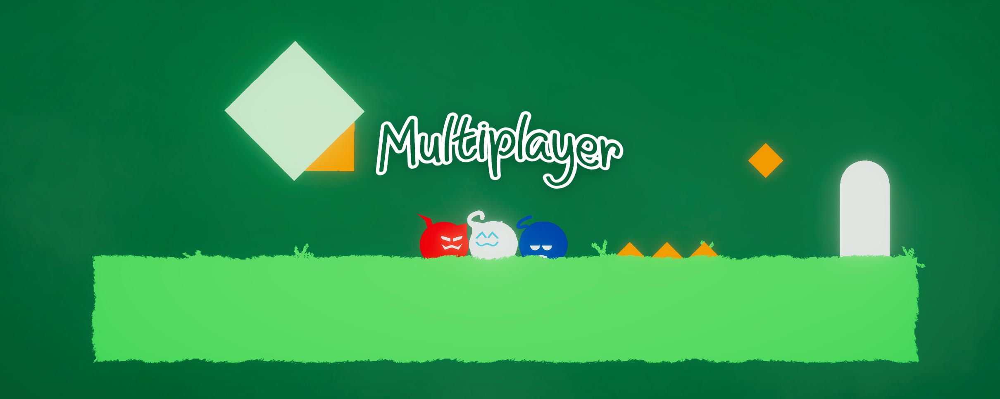

<h1 align="center">Cats are Liquid - A Better Place // Multiplayer Mod</h1>


This is a multiplayer mod for the game [Cats are Liquid - A Better Place](https://store.steampowered.com/app/1188080/Cats_are_Liquid__A_Better_Place/), that uses Steam networking.

# Installation
**To use this mod (or to contribute to the project), you must own the game on Steam.** This mod uses steam networking to make and host lobbies, therefore you cannot use the itch.io version.

## Installation video

## Installation steps
1. Install MelonLoader [from their site](https://melon-loader.com/) or [GitHub (releases)](https://github.com/LavaGang/MelonLoader/releases/), and mod the game
2. Download the mod from [the releases tab](https://github.com/LavaGang/MelonLoader/releases/)
3. Copy the mod into the game's `mods` folder (game's folder can be opened by locating the game in your steam library, then clicking `Settings > Manage > Browse local files`)
4. Launch the game. If you succeeded, there should be a notification telling you the mod loaded correctly.

# Roadmap
This mod is still under development. As such, some features you might expect might not be present yet.

✅ means completed, 🟧 means that this feature is in development, ⬛ means the development has not yet started.
- ✅ Basic Steam lobby creation, leaving, invites, and member list
- ✅ Basic two-player movement and cat-form synchronization (green cat only)
- ⬛ Assigning players to the remaining cat colors
- ⬛ Adding a cat when the worldpack doesn't support
- ⬛ Automatic worldpack sharing (the mod auto-downloads the required worldpack for you)

# Starting a game
1. Both players launch the game through Steam with the mod installed and load the same level.
2. Make sure that level has a pre-placed **green NPC cat**.
3. Press **F1**, host a lobby, and use **Invite Friend** to invite the other player through Steam.
4. Both players should see the other player's cat parts, left/right movement, jump/climb, and liquid/default form changes on the green NPC.

The current implementation supports one remote player. It does not synchronize level loading or create missing NPCs; both players must be in the same level with a green NPC already placed.

# Building and Contributing
These are the steps required if you want to build the project for yourself, or if you want to contribute. **This is NOT required if you just want to play**.

## Prerequsites
You must have **Visual Studio 2022** or **Visual Studio 2026** installed, and you must mod the game using MelonLoader. (Follow the [installation steps or the video](#installation) to mod the game).

## Building
After you modded the game using MelonLoader, follow these steps if you want to build the project.

1. Clone the repository and open the solution (`CalMP_Melon.slnx`)
2. Create the following file
    ```
    (Repository)\CalMP_Melon\Directory.Build.props
    ```
    This file will tell MSBuild where your local game installation is located, allowing the linker to reference the game's assemblies correctly.

3. Edit the following file to include your game path like the example below. To get this path, locate the game in your steam library, then click `Settings > Manage > Browse local files`
    ```xml
    <Project>
      <PropertyGroup>
        <!-- Replace with your own installation path -->
        <GamePath>C:\Program Files (x86)\Steam\steamapps\common\Cats are Liquid - A Better Place</GamePath>
      </PropertyGroup>
    </Project>
    ```
    (The path must be the location of your game install (where the .exe is located), not the mods directory.)
4. Build the project by pressing `CTRL + B` or by going to `Build > Build CalMP_Melon` (or `Build > Build Solution`)
5. Check if MSBuild success copied the mod into the game's `mods` directory, then start the game to test it.

## Contributing
<!-- Before contributing, please read the [contribution guidelines](CONTRIBUTING.md). -->
All contributions on the project are welcome. You can contribute to the code, report bugs or suggest features.

**If you like the project but don't have time to make a contribution directly, that's fine! There are other ways to show your appreciation, for example by sharing it with friends or talking about it on social media.**

### Licensing and copyright
By submitting a Pull Request to this repository, you agree that your contributions will be licensed under the project's current [GNU GPLv3 License](LICENSE).

### Reporting bugs
Please report bugs through the [Issues](https://github.com/cablesalty/CalMP/issues) tab. Before submitting, please check the existing issues to see if they are already reported. If not, open a new issue and include the following details:
- A clear title summarizing the problem
- Steps to reproduce the issue
- Details of your environment (ex.: Your OS, game version)
- Screenshots or error logs (if applicable)

### Submitting a Pull Request
If you are ready to contribute to the project by writing and submitting code:
- Fork the repository, and create your own branch from the `main` branch
- Make your changes **(Make sure they are small and focused on a single task)**
- Test out your changes
- Submit a Pull Request to our `main` branch, with a clear description of the changes you did

After submitting your PR, a maintainer will review your code, request changes if necessary, and merge it when it's ready.

### Again, thank you for contributing to the project!

# AI Usage disclosure
**I believe there should be an AI disclosure on every project you might end up using, so you can consider the usage of it on your own depending on how you view AI generated code.** This project used AI as a major help in implementing the base for the multiplayer syncing to fill in the gaps of my steamworks knowledge. However I would not consider this project a vibecoded project because each change it made and new code it generated had been reviewed, tested properly, and later will be written on top of so the mod is not just two player only. The [previous multiplayer mod](https://github.com/cablesalty/CatsAreLiquid_Multiplayer) was also used by both the AI and me as a reference of previous solutions for the syncing of game specific stuff. I hope this is not a big dealbreaker for most people, as I want to be a person who uses AI responsibly.

# Notes
Thanks to [antalervin19](https://github.com/antalervin19) for doing a big chunk of the early work by helping set up lobbies!